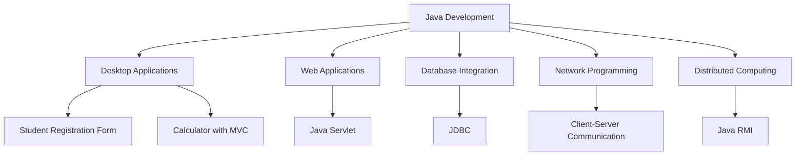
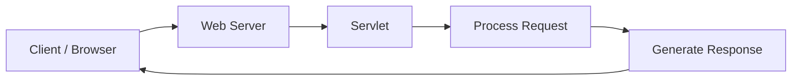
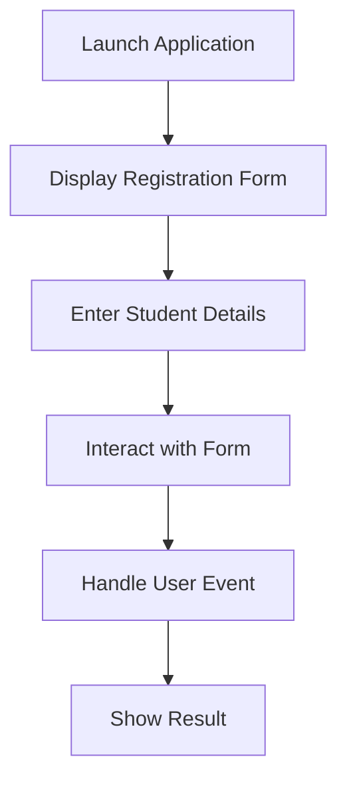
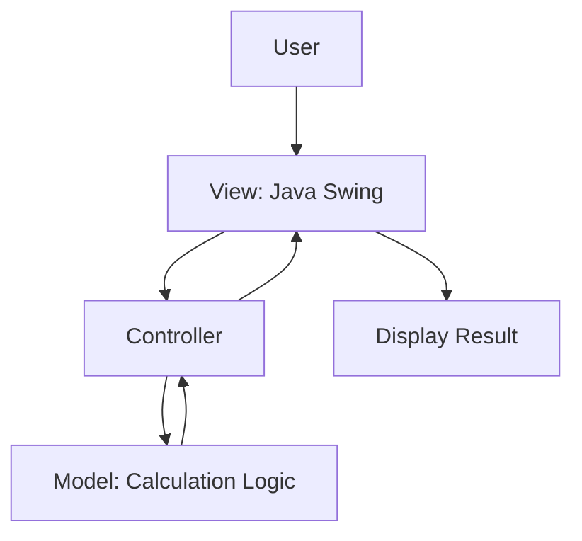
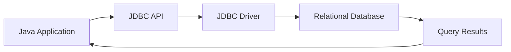
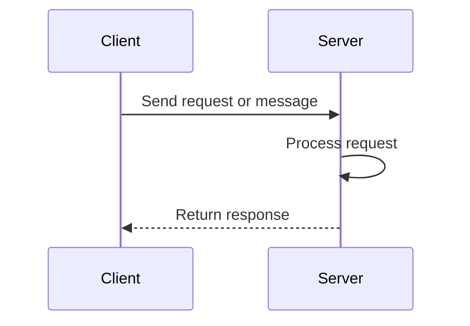
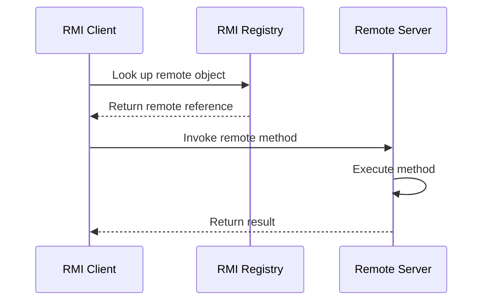

# ☕ Java Development Projects

  
  
  
  

  <b>A collection of Java projects exploring desktop applications, web technologies, database connectivity, networking, and distributed computing.</b>

---

## 📌 About This Repository

Welcome to my Java Development Projects repository!

This repository brings together six projects that demonstrate my practical learning of Java programming and application development. Each project explores a different concept, ranging from graphical user interfaces to communication between distributed applications.

My objective is to develop a strong foundation in Java, object-oriented programming, software architecture, database integration, and networking.

## 🗂️ Project Explorer

| No. | Project | Technology / Concept | Explore |
|---:|---|---|---|
| 01 | Java Servlet | Server-side Java | [View](#1-java-servlet) |
| 02 | Student Registration Form | Java Swing, GUI | [View](#2-student-registration-form) |
| 03 | Calculator | Swing, MVC Architecture | [View](#3-calculator-using-mvc-architecture) |
| 04 | Database Connectivity | JDBC, SQL | [View](#4-jdbc-database-connectivity) |
| 05 | Client-Server Communication | Networking | [View](#5-client-server-communication) |
| 06 | Remote Method Invocation | Java RMI | [View](#6-java-remote-method-invocation-rmi) |

## 🧭 Java Concepts at a Glance

## 🚀 Projects

### 1. Java Servlet

**File:** `Servlet.pdf`

**Overview**

Explores Java Servlets, server-side components used to process requests and generate responses in web applications.

**Concepts explored**

- Servlet lifecycle
- HTTP request and response handling
- Server-side Java programming
- Dynamic web application fundamentals

**Workflow**

**Learning outcome:** Understanding how Java code can handle web requests on the server.

---

### 2. Student Registration Form

**File:** `(GUI) for a student registration form using the Swing framework.pdf`

**Overview**

A graphical interface for entering student information using Java Swing components.

**Concepts explored**

- JFrame and JPanel
- Labels and text fields
- Buttons and event handling
- Form layout and user interaction

**Workflow**

**Learning outcome:** Building interactive desktop interfaces using Java Swing.

---

### 3. Calculator Using MVC Architecture

**File:** `Calculator using Java Swing following MVC Architecture.pdf`

**Overview**

A calculator project demonstrating the Model-View-Controller pattern to separate the interface, calculation logic, and control logic.

**Architecture**

| Component | Responsibility |
|---|---|
| Model | Performs calculations and manages application data |
| View | Displays the calculator interface |
| Controller | Connects user actions with application logic |

**Learning outcome:** Understanding separation of concerns and maintainable application design.

---

### 4. JDBC — Database Connectivity

**File:** `JDBC ( Java Database Connectivity ).pdf`

**Overview**

Explores JDBC, the Java API for connecting applications to relational databases and executing SQL operations.

**Concepts explored**

- JDBC drivers
- Database connections
- SQL query execution
- `Connection`, `Statement`, and `ResultSet`
- Retrieving and manipulating database records

**Workflow**

**Learning outcome:** Understanding how Java applications interact with databases.

---

### 5. Client-Server Communication

**File:** `Server and Client.pdf`

**Overview**

Explores the client-server model, in which separate applications communicate over a network to exchange information.

**Concepts explored**

- Client-server architecture
- Network communication
- Request and response patterns
- Socket programming fundamentals

**Workflow**

**Learning outcome:** Understanding how applications communicate across a network. The exact implementation depends on the networking APIs used in the project.

---

### 6. Java Remote Method Invocation (RMI)

**File:** `RMI.pdf`

**Overview**

Explores Java RMI, which allows a Java application to invoke methods on remote objects running in another Java Virtual Machine.

**Concepts explored**

- Remote interfaces
- Remote objects
- RMI client-server architecture
- Remote method invocation
- Distributed application fundamentals

**Workflow**

**Learning outcome:** Understanding how Java applications can communicate through remote method calls.

---

## 🛠️ Technology Stack

| Technology | Purpose |
|---|---|
| Java | Core programming language |
| Java Swing | Desktop GUI development |
| Java Servlets | Server-side web programming |
| JDBC | Database connectivity |
| SQL | Relational database operations |
| MVC | Application architecture |
| Client-server networking | Communication between applications |
| Java RMI | Remote method invocation |

## 📈 Skills Developed

- Object-Oriented Programming
- GUI development and event-driven programming
- Database integration
- HTTP request and response fundamentals
- Network communication concepts
- Distributed computing fundamentals
- Software design and separation of concerns

## 🎓 Key Takeaways

These projects have helped me explore several layers of application development:

1. **Interface development:** Creating user-facing desktop applications.
2. **Application design:** Organizing logic using architectural patterns.
3. **Database integration:** Connecting Java applications with relational databases.
4. **Web development:** Understanding server-side request processing.
5. **Networking:** Exploring communication between clients and servers.
6. **Distributed systems:** Learning how remote Java objects can be accessed.

## 👩‍💻 About Me

**Khushi Agarwal**  
Computer Science and Engineering Student

I'm interested in strengthening my software development skills through practical projects, exploring new technologies, and building applications that solve real-world problems.

- GitHub: [Visit my GitHub profile](https://github.com/)
- LinkedIn: [Connect with me](https://www.linkedin.com/)

---

  <b>Thanks for exploring my Java projects!</b> 
  ⭐ Feel free to explore the repository and share feedback.

