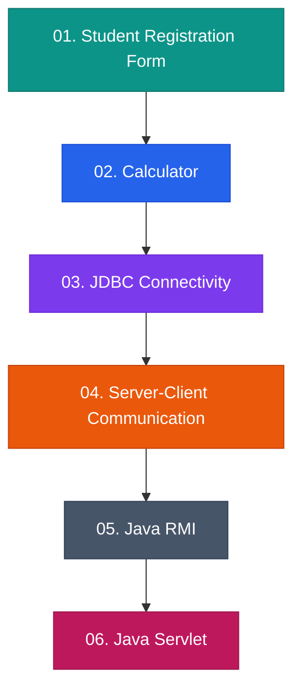
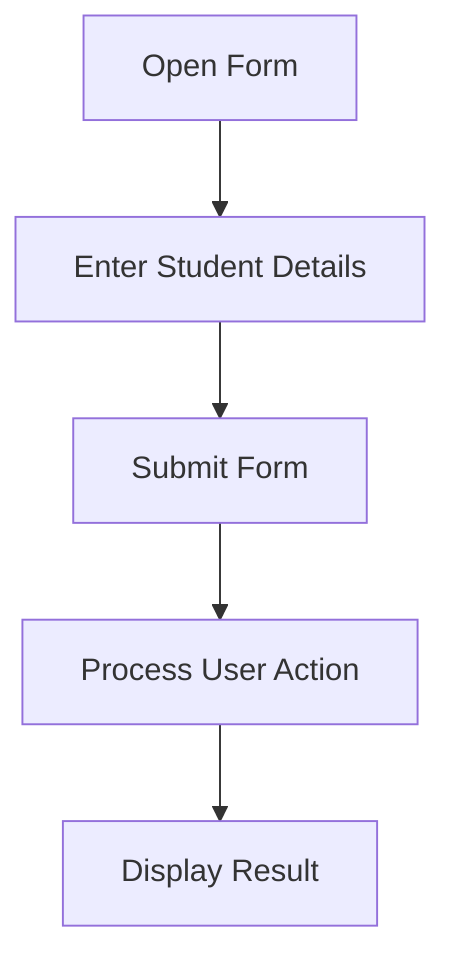
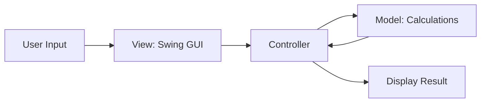
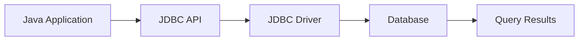
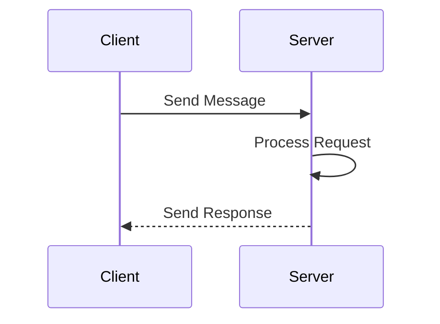
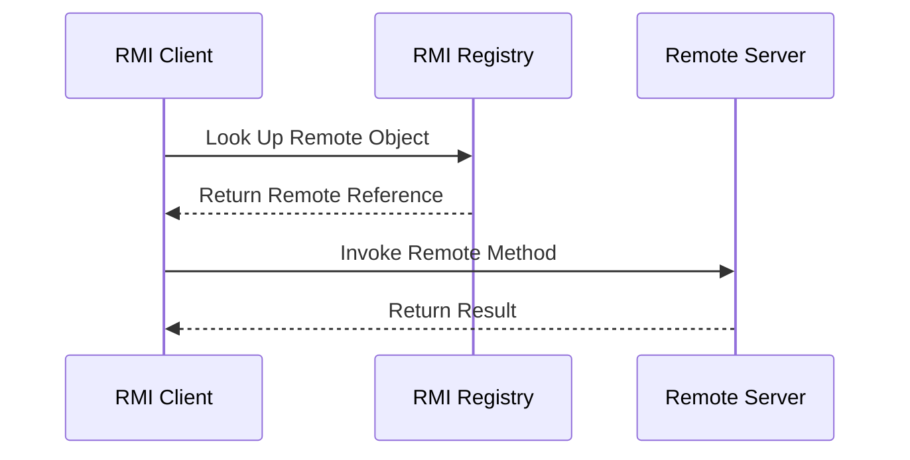
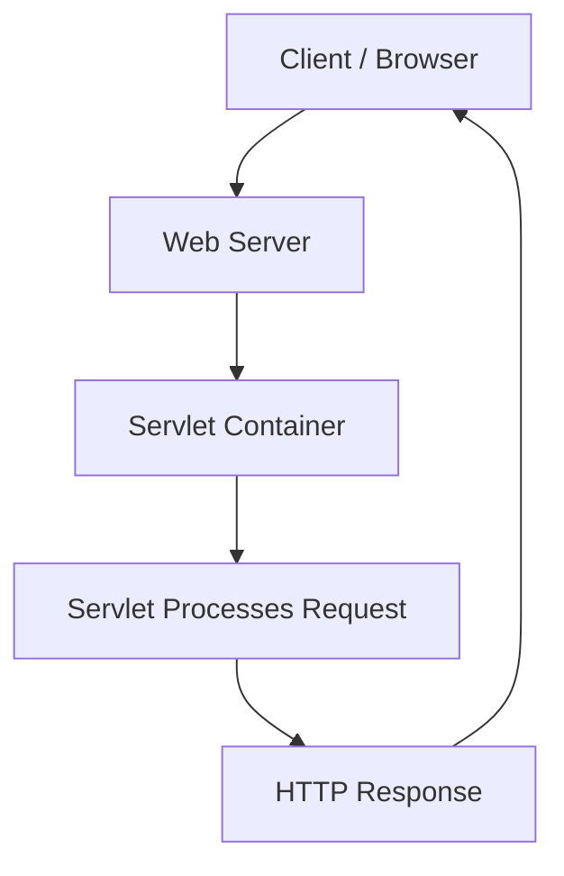

# ☕ Java Development Projects

  
  
  
  

  <b>A collection of Java projects exploring desktop applications, web technologies, database connectivity, networking, and distributed computing.</b>

---

## 📌 About This Repository

Welcome to my Java Development Projects repository!

This repository brings together six projects that demonstrate my practical learning of Java programming and application development. Each project explores a different concept, ranging from graphical user interfaces to communication between distributed applications.

## 🗂️ Project Explorer

| No. | Project | Technology / Concept |
|---:|---|---|
| 01 | [Student Registration Form](#2-student-registration-form-using-java-swing) | Java Swing, GUI |
| 02 | [Calculator Using MVC Architecture](#1-calculator-using-mvc-architecture) | Java Swing, MVC |
| 03 | [JDBC Connectivity](#3-jdbc-database-connectivity) | JDBC, SQL |
| 04 | [Server-Client Communication](#4-server-client-communication) | Networking |
| 05 | [Remote Method Invocation (RMI)](#5-java-remote-method-invocation-rmi) | Distributed Computing |
| 06 | [Java Servlet](#6-java-servlet) | Server-Side Java |

## 🧭 Java Projects Workflow

---

## 🚀 Projects

### 1. Student Registration Form Using Java Swing

**File:** `(GUI) for a student registration form using the Swing framework.pdf`

A graphical registration form demonstrating how users can enter student information through a Java Swing interface.

**Key concepts:** JFrame, JPanel, text fields, buttons, layouts, event handling.

**Workflow:**

### 2. Calculator Using MVC Architecture

**File:** `Calculator using Java Swing following MVC Architecture.pdf`

A calculator application built using Java Swing and the Model-View-Controller (MVC) design pattern.

**Key concepts:** Java Swing, event handling, MVC architecture, separation of concerns, calculation logic.

**Workflow:**

### 3. JDBC Database Connectivity

**File:** `JDBC ( Java Database Connectivity ).pdf`

Explores how Java applications connect to relational databases and execute SQL operations through JDBC.

**Key concepts:** JDBC drivers, Connection, Statement, ResultSet, SQL queries.

**Workflow:**

### 4. Server-Client Communication

**File:** `Server and Client.pdf`

Demonstrates the fundamentals of communication between client and server applications over a network.

**Key concepts:** Client-server architecture, network communication, request-response handling, socket programming concepts.

**Workflow:**

### 5. Java Remote Method Invocation (RMI)

**File:** `RMI.pdf`

Explores how Java applications invoke methods on remote objects running in another Java Virtual Machine.

**Key concepts:** Remote interfaces, remote objects, RMI registry, remote method calls, distributed computing.

**Workflow:**

### 6. Java Servlet

**File:** `Servlet.pdf`

Explores server-side Java programming using Servlets to process client requests and generate web responses.

**Key concepts:** Servlet lifecycle, HTTP requests and responses, request processing, dynamic web applications.

**Workflow:**

---

## 🛠️ Technologies Used

| Technology | Application |
|---|---|
| Java | Programming language |
| Java Swing | Desktop interfaces |
| MVC | Software architecture |
| JDBC | Database connectivity |
| SQL | Database queries |
| Client-server networking | Network communication |
| Java RMI | Remote method invocation |
| Java Servlets | Server-side web development |

## 📈 Skills Developed

- Object-Oriented Programming
- GUI development and event-driven programming
- Database integration
- HTTP request and response fundamentals
- Network communication concepts
- Distributed computing fundamentals
- Software design and separation of concerns

## 🎓 Key Takeaways

These projects have helped me explore several layers of application development:

1. **Interface development:** Creating user-facing desktop applications.
2. **Application design:** Organizing logic using architectural patterns.
3. **Database integration:** Connecting Java applications with relational databases.
4. **Web development:** Understanding server-side request processing.
5. **Networking:** Exploring communication between clients and servers.
6. **Distributed systems:** Learning how remote Java objects can be accessed.

## 👩‍💻 About Me

**Khushi Agarwal**  
Computer Science and Engineering Student

I'm interested in strengthening my software development skills through practical projects, exploring new technologies, and building applications that solve real-world problems.

- GitHub: [Visit my GitHub profile](https://github.com/)
- LinkedIn: [Connect with me](https://www.linkedin.com/)

---

  <b>Thanks for exploring my Java projects!</b> 
  ⭐ Feel free to explore the repository and share feedback.

